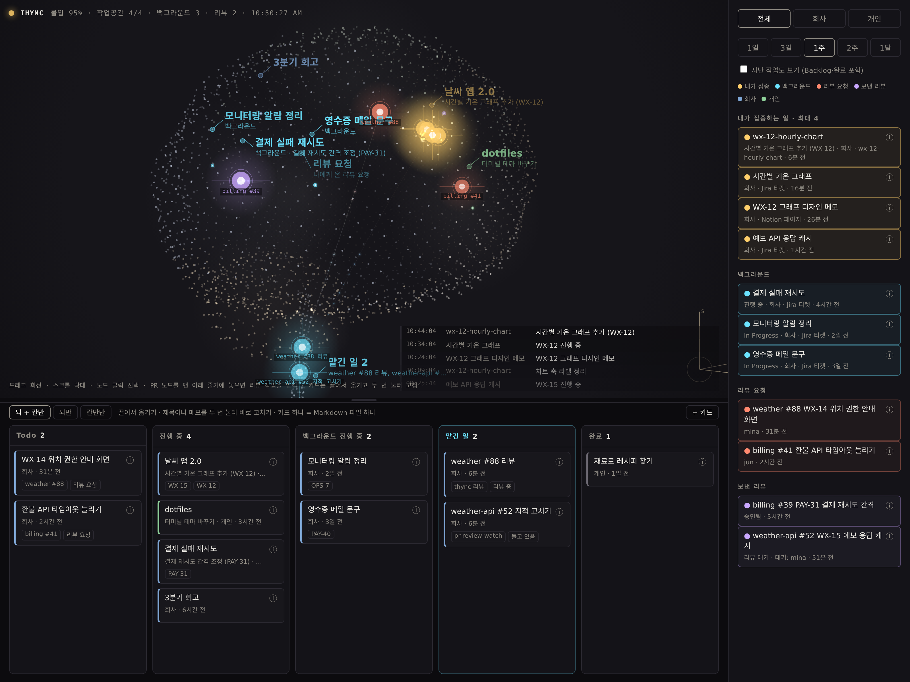

# thync

**thync는 현재 진행 중인 일을 한곳에 모아, 사용자와 AI 에이전트가 같은 작업 맥락을 공유하도록 돕는 로컬 웹 앱입니다.** 이름은 *think*와 *sync*를 합쳤습니다.

사용자는 뇌 모양 그래프와 칸반 보드로 작업 상태를 확인합니다. AI 에이전트는 MCP 도구 `thync_now`로 같은 맥락을 짧은 글로 조회합니다.



*화면의 저장소·티켓·사람 이름은 모두 지어낸 예시입니다.*

## 어떤 문제를 해결하나요

AI 에이전트에게 작업을 요청할 때마다 지금 하던 일과 관련 티켓, PR을 다시 설명하게 됩니다. 여러 에이전트에게 일을 맡기면 무엇을 넘겼고 무엇이 아직 진행 중인지 놓치기도 쉽습니다.

thync는 여러 서비스에 흩어진 활동을 작업 단위로 묶습니다. 사용자는 집중하는 일과 기다리는 일을 한눈에 확인하고, 에이전트는 작업 요약을 조회해 다음 요청의 배경을 파악합니다. 반복 설명과 개별 조회에 드는 수고와 토큰을 줄이는 것이 목표입니다.

## 어떻게 사용하나요

1. **활동을 모읍니다.** GitHub 커밋·리뷰 요청·내 PR, 나에게 배정된 Jira 티켓, 최근 수정한 Notion 페이지를 읽습니다. Claude Code 세션 로그도 설정에 따라 읽습니다.
2. **관련 활동을 작업 단위로 묶습니다.** 같은 Jira 에픽·티켓, 브랜치 또는 저장소에 속한 활동을 연결합니다.
3. **상태를 확인하고 작업을 이어갑니다.** 사용자는 그래프와 칸반을 보고, 에이전트는 `thync_now`로 현재 맥락을 조회합니다. 필요한 PR 작업은 확인 창을 거쳐 Claude에게 맡깁니다.

| 기능 | 할 수 있는 일 |
| --- | --- |
| 뇌 그래프 | 활동에서 추정한 집중도에 따라 작업의 위치와 밝기를 표시하고, 새 활동을 신호로 보여 줍니다 |
| 오른쪽 패널 | 집중하는 일, 백그라운드 작업, 받은 리뷰 요청, 리뷰를 기다리는 내 PR을 확인합니다 |
| 칸반 보드 | 카드를 끌어 옮기고 제목·메모를 편집합니다. 변경 내용은 Markdown 파일로 저장합니다 |
| MCP 연동 | 에이전트가 `thync_now`로 현재 작업을 짧은 글로 조회합니다 |
| PR 위임 | Claude에게 다른 사람의 PR 리뷰나 내 PR의 후속 작업을 맡깁니다. `claude` CLI 등 [실행 조건](docs/handoff.md#실행-조건-확인)이 필요합니다 |

뇌 그래프는 작업 이력을 표현하는 시각화입니다. 실제 집중력을 측정하지 않으며, 배치와 밝기의 의미는 [화면 사용법](docs/usage.md)에 설명합니다.

## 빠른 시작

### 1. 준비하고 실행합니다

Python 3.10 이상, 화면 빌드용 Node.js 18 이상, 인증된 [GitHub CLI](https://cli.github.com/)가 필요합니다. GitHub CLI는 `gh auth login`으로 인증합니다. Python은 표준 라이브러리만 사용하며, Jira·Notion·Claude Code 연동은 선택 사항입니다.

```bash
git clone https://github.com/choiahrok/thync.git
cd thync
npm ci
npm run build
python3 -m thync
```

### 2. 브라우저에서 접속합니다

서버를 실행한 채 다른 터미널에서 접근 토큰을 확인합니다.

```bash
cat "${THYNC_HOME:-$HOME/.thync}/token"
```

출력된 토큰을 넣어 `http://127.0.0.1:8765/#t=<토큰>`을 한 번 엽니다. 브라우저가 토큰을 기억하므로 이후에는 `http://127.0.0.1:8765/`로 접속합니다. 서버를 종료하려면 실행한 터미널에서 `Ctrl+C`를 누릅니다.

### 3. 필요한 출처와 에이전트를 연결합니다

설정 파일이 없으면 GitHub·Jira·Notion·Claude Code 네 출처가 기본으로 활성화됩니다. Jira와 Notion의 API 수집에는 별도 인증 설정이 필요합니다. Claude Code 세션 로그를 읽지 않으려면 `sources`에서 `claude_code`를 제외합니다. [예제 설정](config.example.json)은 세션 로그를 제외한 구성입니다.

- Jira·Notion을 연결하거나 수집할 출처를 바꾸려면 [설정 안내](docs/configuration.md)를 확인합니다.
- 에이전트가 현재 맥락을 조회하게 하려면 [MCP 등록 방법](docs/usage.md#에이전트에서-지금-하는-일-묻기-mcp)을 확인합니다.
- 원격 접속이나 실행 문제는 [설치와 실행](docs/getting-started.md)에서 확인합니다.

## 데이터는 어떻게 다루나요

설정과 수집 데이터는 기본적으로 `~/.thync/`에 저장합니다. 웹 서버는 `127.0.0.1`에서 실행하며, 데이터 조회와 변경에는 접근 토큰이 필요합니다.

GitHub·Jira·Notion 활동은 각 서비스에서 조회합니다. Jira와 Notion에는 쓰지 않습니다. PR을 위임하면 Claude CLI가 관련 내용을 처리하며, 다른 사람의 PR 리뷰 결과는 GitHub에 게시합니다. 내 PR에 실행한 스킬은 코드를 수정하고 push할 수 있습니다. 자세한 범위는 [데이터와 보안](docs/security.md)에 설명합니다.

## 더 알아보기

처음 사용한다면 **설치 → 화면 사용법 → 필요한 연동 설정** 순서로 읽으면 됩니다. 전체 목록과 목적별 안내는 [문서 목차](docs/README.md)에 있습니다.

| 알고 싶은 내용 | 문서 |
| --- | --- |
| 설치, 첫 접속, SSH 접속, 문제 해결 | [설치와 실행](docs/getting-started.md) |
| 화면·색상, 칸반 카드, MCP 등록 | [화면, 칸반과 MCP](docs/usage.md) |
| 설정 키, 저장 파일, Jira·Notion 연결, 수집 주기 | [설정과 외부 서비스 연결](docs/configuration.md) |
| PR 리뷰, 자동 승인 조건, 내 PR의 후속 작업 | [Claude에게 일 맡기기](docs/handoff.md) |
| 접근 토큰, 외부 전송, 쓰기 권한 | [데이터와 보안](docs/security.md) |
| 코드 구조, 데이터 흐름, HTTP API, 출처 추가 | [아키텍처](docs/architecture.md) |
| 밝기·집중·배치 규칙, 상수와 연구 근거 | [뇌 모델과 근거](docs/brain-model.md) |

## 향후 계획

현재는 활동 이력으로 집중도와 우선순위를 추정합니다. 앞으로는 사용자가 직접 작업 순서를 정하고, 에이전트가 그 순서에 따라 일하도록 확장할 계획입니다.

동료가 무엇에 집중하는지 공유하는 기능도 구상하고 있습니다.

## 개발

저장소 루트에서 다음 명령으로 검증합니다.

```bash
python3 -m unittest discover tests
npm run typecheck
npm run build
```

화면 코드를 수정할 때는 `npm run watch`로 저장할 때마다 다시 빌드합니다. 변경 사항은 브라우저를 새로고침해 확인합니다. 코드 구조와 확장 방법은 [아키텍처](docs/architecture.md)에 설명합니다.

## 출처와 라이선스

뇌 그래프를 그리는 코드는 [brain-atlas](https://github.com/colorpulse6/brain-atlas)(MIT, colorpulse6)에서 가져와 수정했습니다. 가져온 범위와 수정 내역은 [외부 코드 안내](vendor/brain-atlas/README.md)에서 확인할 수 있습니다.

thync는 [MIT 라이선스](LICENSE)로 공개합니다.
