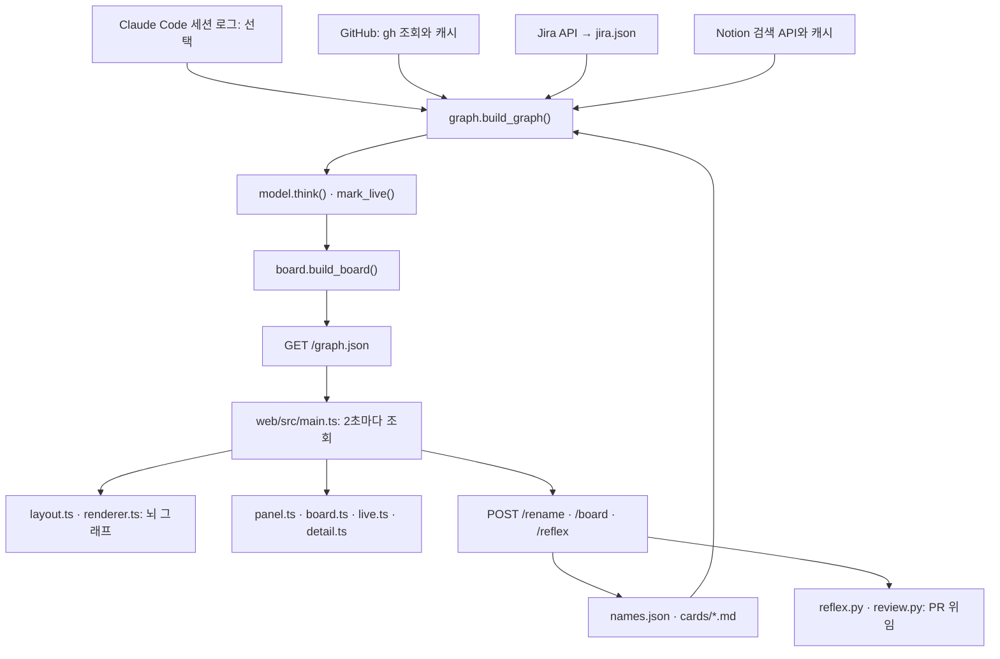

# 아키텍처

[문서 목차](README.md) · [프로젝트 소개](../README.md)

thync는 Python 로컬 서버와 TypeScript 웹 화면으로 나뉩니다. Python은 표준 라이브러리만 사용하고, 화면은 esbuild로 한 파일에 묶습니다. 화면은 `GET /graph.json`으로 그래프를 읽고, 이름 변경·카드 편집·PR 위임은 별도 POST 요청으로 보냅니다.

출처별 데이터를 같은 그래프 형식으로 바꾸므로, 기존 스키마 안에서 출처를 바꾸거나 추가하면 화면을 그대로 사용할 수 있습니다. 같은 데이터 인터페이스를 Chrome 확장 같은 다른 화면에서도 사용할 수 있습니다.

## 이 문서에서 찾기

- [데이터 흐름](#데이터-흐름)
- [작업 단위](#작업-단위), [활동 출처](#활동-출처last_at), [진행 중 판정](#진행-중live)
- [서버 모듈](#서버-thync)
- [화면 모듈](#화면-websrc)
- [그래프 조회 API](#get-graphjson-schema-1), [쓰기 API](#쓰기-요청)
- [출처 추가](#출처를-더하려면), [외부 렌더러](#brain-atlas)

## 데이터 흐름

설정과 저장 파일은 기본 `~/.thync/`에 둡니다. 세션 로그는 `~/.claude/projects/` 아래의 JSONL 파일에서 읽습니다. 외부 수집 주기는 [설정 안내](configuration.md#수집-주기와-범위)에 정리했습니다.

## 작업 단위

활동의 출처(세션, 커밋, 배정된 티켓, Notion 페이지)는 하나의 작업 단위에 속합니다. 순서대로 처음 일치하는 기준을 적용합니다.

1. 브랜치 이름, 세션 제목, 커밋 메시지, 페이지 제목에 Jira 키가 있으면: 티켓에 에픽이 있으면 에픽(`epic:KEY`), 없으면 티켓(`jira:KEY`)
2. 기본 브랜치가 아니면: 브랜치(`branch:<repo>:<branch>`)
3. 저장소 폴더나 기본 브랜치 커밋이면: 저장소(`repo:<repo>`)
4. 그 밖: 세션 하나(`session:<id>`)나 Notion 페이지 하나(`notion:<id>`)

제목·메시지 속 대문자 키(`ABC-123`)는 같은 접두어가 브랜치 이름이나 배정된 티켓에 나올 때만 Jira 키로 봅니다.

## 활동 출처(`last_at`)

`detail.last_at`이 있는 노드가 활동 출처입니다. 세션 로그를 읽는 모드에서는 세션만 `last_at`을 가집니다. 아래 다른 출처의 시각은 세션 로그를 읽지 않을 때 작업공간 경쟁에 사용합니다. `model.think()`는 활동 출처 중 작업공간에 포함할 항목을 선택하고, 나머지 노드는 출처에서 퍼진 활성으로 밝기가 정해집니다.

| 출처 | 노드 | `last_at` |
| --- | --- | --- |
| Claude Code 세션 | `session:<id>` | 마지막 프롬프트 |
| 기본 브랜치가 아닌 브랜치의 커밋·push | `branch:<repo>:<branch>` | 마지막 push |
| 기본 브랜치 커밋 | 메시지의 Jira 티켓, 없으면 `repo:<repo>` | 커밋 시각 |
| 나에게 배정된 티켓 | `jira:<KEY>` | 티켓 `updated` |
| Notion 페이지 | `notion:<id>` | `last_edited_time` |

백그라운드(`running`)는 Claude가 일하는데 내가 입력하지 않는 세션, 또는 진행 중인 내 티켓 가운데 작업공간 단위에 들지 못한 것입니다.

리뷰 요청과 내 PR은 제목의 Jira 키가 가리키는 작업 단위로 들어가고, 없으면 `review`, `sent` 묶음에 모입니다. 여러 단위가 함께 쓰는 저장소는 `common`이 되고 화면에는 올리지 않습니다.

## 진행 중(live)

집중·백그라운드 작업, 최근 24시간 안에 활동한 출처, 열린 리뷰 요청, 리뷰를 기다리는 내 PR이 기준 노드입니다. 기준 노드와 바로 이어진 노드도 진행 중입니다. 다만 Jira 상태가 할 일이나 완료인 티켓은 이어져 있어도 제외합니다. 화면은 기본으로 진행 중인 것만 뇌에 올립니다.

## 서버 (`thync/`)

| 파일 | 하는 일 |
| --- | --- |
| `__main__.py` | `python3 -m thync` 진입점 |
| `config.py` | 경로(`THYNC_HOME`), `config.json` 읽기, 출처 선택(`SOURCES`), PR 맡기기 가능 여부(`HANDOFF`), 시간 창과 모델 상수 |
| `util.py` | 시각 변환, JSON 읽기·원자적 쓰기 |
| `store.py` | `~/.thync`의 파일: 토큰, 바꾼 이름, 칸반 카드(Markdown), 맡긴 일 기록 |
| `sources/claude_code.py` | Claude Code 세션 로그를 새로 붙은 줄만 이어 읽습니다 |
| `sources/github.py` | `gh`로 리뷰 요청, 내 PR, 내 커밋을 조회합니다. 커밋은 `search/commits`(`author:@me`, 기본 브랜치만 검색 대상)와 내 PushEvent(브랜치별 마지막 push, 그 head 커밋 메시지)를 합칩니다. 백그라운드 스레드는 1분마다 갱신을 시도하고 결과를 기본 120초 동안 재사용합니다 |
| `sources/jira.py` | `jira.json`의 티켓 요약과 에픽, 브랜치·제목에서 Jira 키 찾기. 설정하면 백그라운드 스레드가 그래프에 나온 키와 나에게 배정된 티켓(`/rest/api/3/search/jql`)을 Jira REST API로 받아 `jira.json`을 갱신하고, 배정된 티켓에 `mine: true`를 기록합니다 |
| `sources/notion.py` | Notion API `POST /v1/search`로 최근에 고친 페이지를 받습니다. 토큰이 있을 때 백그라운드 스레드가 1분마다 갱신을 시도하고 결과를 기본 120초 동안 재사용합니다 |
| `graph.py` | 출처를 모아 노드·연결·작업 단위·활동 목록을 만듭니다 |
| `model.py` | 연구에서 가져온 규칙으로 밝기, 상태, 작업공간, 진행 중 여부를 정합니다 ([brain-model.md](brain-model.md)) |
| `board.py` | 칸반 카드와 자동 칸을 계산하고, 카드 파일에 사용자가 지정한 값을 최종 카드에 적용합니다. 파일 저장은 `store.py`가 맡습니다 |
| `reflex.py` | PR을 Claude에게 맡깁니다. 내 PR은 로컬 저장소를 찾아 tmux에서 Claude Code를 실행하고, 남의 PR은 `review.py`로 넘깁니다 |
| `review.py` | 남의 PR을 임시 폴더에 받아 `claude -p --restricted`로 읽기만 시키고, 돌려받은 리뷰를 확인해 올립니다 |
| `server.py` | HTTP 처리, 토큰 확인, 화면 파일 제공 |
| `mcp.py` | 표준 입출력 MCP 서버. `thync_now` 도구로 패널과 '맡긴 일' 목록을 짧은 글로 반환합니다 |

## 화면 (`web/src/`)

| 파일 | 하는 일 |
| --- | --- |
| `main.ts` | 진입점. 2초마다 `/graph.json`을 가져와 `apply()`로 다시 그립니다. 탭·기간 조작 |
| `state.ts` | 공유 상태(데이터, 그래프, 탭, 기간)와 localStorage 기억 |
| `api.ts` | 토큰을 붙인 요청. 주소의 `#t=`를 한 번 읽어 저장합니다 |
| `types.ts` | `/graph.json`의 타입 |
| `style.ts` | 색과 짧은 글자 도우미 |
| `layout.ts` | 작업 단위를 집중도 단계별 자리에 놓고, 노드 위치와 제목을 만듭니다 |
| `renderer.ts` | brain-atlas 렌더러를 상속해 신호 연쇄, 터뜨리기, 척수에 놓기를 더합니다 |
| `panel.ts` | 오른쪽 패널 목록과 상단 상태 줄 |
| `board.ts` | 칸반: 끌어 옮기기, 그 자리 편집, 보기 모드, 높이 조절 손잡이, 카드 추가 |
| `detail.ts` | 상세 모달과 이름 바꾸기 |
| `reflex.ts` | Claude에게 맡기기 확인 창 |
| `live.ts` | 실시간 활동 목록, 점화·두드러짐·되짚기 반응 |

브라우저에 저장하는 값(`localStorage`의 `thync.*`)은 토큰, 탭, 기간, 지난 작업 보기, 보기 모드, 칸반 높이입니다.

## `GET /graph.json` (schema 1)

`X-Thync-Token` 헤더가 필요합니다. `?days=1..30`으로 기간을 선택합니다(기본 7).

| 필드 | 내용 |
| --- | --- |
| `schema` | 형식 버전. 지금은 1 |
| `generated` | 만든 시각 (초) |
| `days` | 기간 (일) |
| `focus_level` | 몰입 정도 0..1 |
| `handoff` | PR을 Claude에게 맡길 수 있는지 (`claude` CLI가 있고 `sources`에 `claude_code`가 있을 때 `true`). `false`면 화면이 '맡긴 일' 칸을 숨깁니다 |
| `units[]` | 작업 단위: `id`, `name`, `auto_name`, `title`(세션 모드에서는 가장 최근 세션 제목), `profile`, `sessions`, `keys`, `working`, `count`, `updated`, `glow` |
| `nodes[]` | `id`, `name`, `kind`, `profile`, `glow`, `status`(`active`·`dormantRelevant`·`archived`), `roles`(`focus`·`running`·`review`·`sent`), `detail`(아래) |
| `edges[]` | 노드 id 두 개 |
| `activity[]` | 최근 활동(세션 로그를 읽으면 30분, 아니면 24시간): `at`, `kind`(`prompt`·`tool`·`commit`·`jira`·`notion`), `text`, `session`(활동한 노드 id), `title`, `profile` |
| `board[]` | 칸반 카드: `id`, `title`, `sub`, `column`, `auto_column`, `moved`, `note`, `file`, `profile`, `updated`, `focus`, `tags` |

### 노드 종류

`nodes[].kind`는 brain-atlas의 노드 종류를 빌려 사용합니다.

| `kind` | thync에서의 의미 |
| --- | --- |
| `workThread` | Claude Code 세션 |
| `repo` | 저장소 |
| `tool` | 브랜치 |
| `project` | Jira 티켓 |
| `source` | PR |
| `incident` | 나에게 온 리뷰 요청 |
| `dailyNote` | 파일 또는 Notion 페이지 |

### 노드 상세 정보

`nodes[].detail`은 노드에 따라 필요한 키만 포함합니다.

| 키 | 의미 |
| --- | --- |
| `unit` | 작업 단위 ID |
| `live` | 진행 중 판정 |
| `act` | 활성 정도, 0~1 |
| `kind_label`, `text` | 종류 표시와 설명 |
| `url` | 관련 항목 링크 |
| `repo`, `branch`, `cwd` | 저장소·브랜치·작업 폴더 |
| `updated`, `last_at` | 갱신 시각과 활동 출처의 마지막 활동 시각(초) |
| `claude_working`, `subagents` | Claude 작업 여부와 하위 에이전트 수 |
| `reflex` | 맡긴 PR 주소 |
| `review_state`, `reviewers`, `author` | 리뷰 상태·리뷰어·작성자 |
| `jira_status` | Jira 상태 |
| `auto_name` | 사용자가 바꾸기 전 자동 이름 |

## 쓰기 요청

모두 `X-Thync-Token`이 필요하고 JSON 객체 본문을 받습니다. 아래 `?` 표시는 선택 필드입니다.

| 요청 | 본문 | 하는 일 |
| --- | --- | --- |
| `POST /rename` | `{id, name}` | 노드 이름을 바꿉니다. 빈 이름이면 원래 이름으로 |
| `POST /board` | `{id, column?, title?, note?, reset?}` 또는 `{new: true, title, column?, profile?}` | 카드 파일을 고치거나 새 카드를 만듭니다 |
| `POST /reflex` | `{id, approve?}` | PR 노드를 Claude에게 맡깁니다 |

`/rename`과 `/board` 성공 응답은 본문 없는 `204`입니다. `/reflex`는 HTTP 상태와 함께 `{"message": "..."}`를 돌려주며, 시작 성공은 `202`, 이미 실행 중이면 `409`, 위임 기능이 꺼져 있으면 `503`입니다. 토큰이 없거나 틀리면 `401`, 로컬 호스트가 아닌 `Host`이면 `403`을 반환합니다.

카드의 일반 `column` 값은 `todo`, `doing`, `background`, `done`입니다. `reflex`는 PR 위임 결과에서 생성되며 `/board`로 직접 지정할 수 없습니다. `reset: true`는 수동으로 지정한 칸을 해제합니다. 카드 파일 형식은 [사용법](usage.md#칸반-카드-파일), PR 위임의 동작과 권한은 [위임 안내](handoff.md)에 있습니다.

## 출처를 더하려면

`thync/sources/`에 모듈을 하나 더하고, `graph.build_graph()`에서 그 결과를 `node()`와 `edge()`로 넣습니다. 노드에 `detail.unit`을 주면 그 작업 단위에 모이고, `roles`를 주면 색과 패널 목록이 반영됩니다. 화면은 고치지 않아도 됩니다.

## brain-atlas

`vendor/brain-atlas/`는 [colorpulse6/brain-atlas](https://github.com/colorpulse6/brain-atlas)의 Canvas2D 렌더러를 가져온 것입니다. 수정 지점은 `thync:` 주석으로 표시했습니다. 기준 커밋, 가져오지 않은 파일, 수정 내역과 라이선스는 [외부 코드 안내](../vendor/brain-atlas/README.md)에 있습니다.
