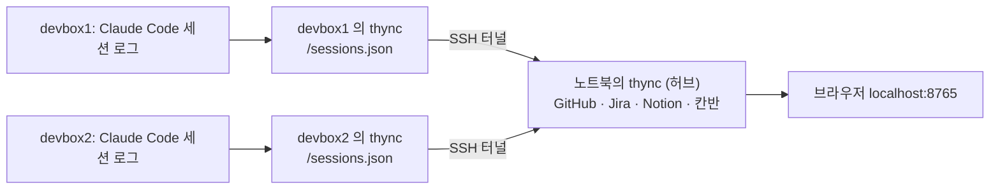

# 설정과 외부 서비스 연결

[문서 목차](README.md) · [프로젝트 소개](../README.md)

개인 정보와 회사 관련 값은 저장소에 넣지 않고 `~/.thync/`에 둡니다. 위치는 환경 변수 `THYNC_HOME`으로 바꿀 수 있습니다. 설정 파일은 없어도 동작하며, 쓰려면 [config.example.json](../config.example.json)을 `~/.thync/config.json`으로 복사해 수정합니다.

## 설정 파일 만들기

저장소 루트에서 다음 명령을 실행한 뒤 `config.json`을 편집합니다.

```bash
install -d -m 700 "${THYNC_HOME:-$HOME/.thync}"
cp config.example.json "${THYNC_HOME:-$HOME/.thync}/config.json"
```

예제 파일의 회사 폴더·이메일·Jira 주소는 자신의 값으로 바꿉니다. 설정은 시작할 때 읽으므로 수정 후 서버를 재시작합니다.

## 설정 키

설정 파일을 생략했을 때의 기본값입니다. **예제 파일은 `claude_code`와 `codex`를 제외한 세 출처만 사용합니다.** 세션 로그도 읽으려면 `sources`에 직접 추가합니다.

```json
{
  "sources": ["claude_code", "codex", "github", "jira", "notion"]
}
```

| 키 | 뜻 | 기본값 |
| --- | --- | --- |
| `sources` | 읽을 출처. `claude_code`(Claude Code 세션 로그), `codex`(Codex CLI 세션 로그), `github`(내 커밋, 리뷰 요청, 내 PR), `jira`(나에게 배정된 티켓), `notion`(최근에 고친 페이지) | 다섯 가지 모두 |
| `company_roots` | 이 폴더 아래에서 시작한 세션은 회사 프로필이 됩니다. PR을 맡길 때 로컬 저장소를 찾는 위치이기도 합니다 | `[]` (세션은 모두 개인) |
| `jira_browse_url` | Jira 티켓 링크 앞부분 (예: `https://example.atlassian.net/browse/`). 티켓 정보를 받아 올 주소도 여기서 정합니다 | 없음 (링크 없음) |
| `jira_email` | Jira Cloud 계정 이메일. API 토큰과 함께 있으면 티켓 요약·상태·상위 이슈를 자동으로 받아 옵니다 | 없음 (`jira.json`을 손으로 채움) |
| `cards_dir` | 칸반 카드 파일을 둘 폴더. Obsidian vault 안 폴더를 지정해도 됩니다 | `<THYNC_HOME>/cards` (기본 `~/.thync/cards`) |
| `port` | 서버 포트 | `8765` |
| `reflex_skills` | 내 PR을 맡길 때 실행할 Claude Code 스킬 (`sent`) | `pr-review-watch` |
| `ask_wait_sec` | 질문 hook 이 thync 의 답을 기다리는 시간(초). 지나면 세션이 직접 묻습니다 ([사용법](usage.md#선택-대기-질문에-thync-에서-답하기-pretooluse-hook)) | `300` |
| `remotes` | 이 화면에 함께 보일 다른 서버 목록. `[{"name": "devbox1", "ssh": "devbox1"}]`. `ssh`는 `ssh` 명령에 주는 호스트, `port`(기본 `8765`)와 `thync_home`(기본 `~/.thync`)은 그 서버의 thync 값입니다 ([여러 서버를 한 화면에서](#여러-서버를-한-화면에서)) | `[]` |
| `reflex_host` | PR 을 맡길 때 Claude 를 실행할 서버(`remotes`의 `name`). 그 서버의 저장소와 tmux 에서 돕니다 | 없음 (이 머신) |
| `notion_user_id` | 이 Notion 사용자가 마지막으로 고친 페이지만 사용합니다 | 없음 (integration이 볼 수 있는 페이지 모두) |

## 저장 파일

`~/.thync/`에 생기는 파일은 다음과 같습니다. 폴더는 나만 읽을 수 있게(0700) 만듭니다.

| 파일 | 내용 |
| --- | --- |
| `config.json` | 직접 만드는 설정 파일 (선택) |
| `token` | 접근 토큰 |
| `jira.json` | Jira 티켓 요약과 에픽: `{"ABC-1": {"summary": "...", "status": "진행 중", "epic": "ABC-0", "epic_summary": "..."}}`. 자동 수집 시 배정 티켓은 약 5분, 발견한 키의 요약은 약 10분마다 갱신합니다. 인증 설정이 없으면 직접 작성합니다 |
| `jira_token` | Jira API 토큰 (선택). 환경 변수 `JIRA_API_TOKEN`으로 줘도 됩니다. `chmod 600`으로 둡니다. 다른 사용자가 읽을 수 있으면 서버 로그에 경고를 남깁니다 |
| `notion_token` | Notion integration 토큰 (선택). 환경 변수 `NOTION_TOKEN`으로 줘도 됩니다. `chmod 600`으로 둡니다. 다른 사용자가 읽을 수 있으면 서버 로그에 경고를 남깁니다 |
| `names.json` | 화면에서 바꾼 노드 이름 |
| `cards/*.md` | 칸반 카드 ([파일 형식](usage.md#칸반-카드-파일)) |
| `reflex.json` | Claude에게 맡긴 PR과 진행 상태 (tmux 세션 이름이나 리뷰 결과) |

## 여러 서버를 한 화면에서

개발 서버가 여러 대일 때, 서버마다 thync 를 그대로 돌려 두고 노트북의 thync 하나(허브)가 그 세션을 모아 한 뇌에 보여 줍니다. 세션 로그는 서버 밖으로 나가지 않고, 각 서버의 thync 가 읽어 정리한 세션만 SSH 터널로 옵니다.



1. 각 서버에서 thync 를 실행합니다([시작하기](getting-started.md)). 설정은 그대로 둬도 됩니다. 그 서버의 SessionStart·질문 hook 도 그대로 그 서버의 thync 를 씁니다.
2. 허브가 될 머신에서 각 서버에 비밀번호 없이 `ssh <호스트>`로 들어갈 수 있어야 합니다(`ssh-copy-id <호스트>`). 허브는 `BatchMode`로 접속하므로 비밀번호나 호스트 키 확인을 묻지 않습니다.
3. 허브의 `~/.thync/config.json`에 서버를 적고 허브를 재시작합니다.

```json
{
  "remotes": [{"name": "devbox1", "ssh": "devbox1"}, {"name": "devbox2", "ssh": "devbox2"}],
  "reflex_host": "devbox1",
  "company_roots": ["~/work"]
}
```

허브는 서버마다 SSH 터널을 하나 열고, 그 서버의 `~/.thync/token`을 SSH 로 한 번 읽은 뒤 1.5초마다 세션을 받아 옵니다. 바뀐 것이 없으면 본문 없이 `304`만 오갑니다. 상단 상태 줄 끝에 서버마다 `devbox1 ✓`, 연결되지 않으면 `devbox1 ✕ <이유>`가 보입니다. 터널이 끊기면 2초에서 30초까지 간격을 늘리며 다시 엽니다. 연결이 안 되는 동안 그 서버의 세션은 뇌에 남지만 작업 중으로 치지 않습니다.

- **프로필**: 다른 서버의 세션이 회사인지 개인인지는 그 서버의 `company_roots`로 정합니다. 허브의 `company_roots`는 허브 자신의 세션에만 씁니다.
- **선택 대기 질문**: 화면에서 고른 답은 그 세션이 있는 서버의 thync 로 넘어갑니다. 그 서버에 질문 hook 이 등록되어 있어야 합니다([사용법](usage.md#선택-대기-질문에-thync-에서-답하기-pretooluse-hook)).
- **PR 맡기기**: `reflex_host`를 주면 그 서버의 저장소와 tmux 에서 Claude 가 돕니다. 칸반의 맡긴 일 카드에는 `ssh -t <호스트> tmux attach -t <이름>`이 보입니다.
- **GitHub·Jira·Notion·칸반·이름 바꾸기**: 허브의 설정과 `~/.thync`를 씁니다. 서버의 thync 가 이 출처를 켜 두어도 허브는 세션만 가져오므로 중복되지 않습니다.
- **허브 자신의 세션**: 허브 머신의 Claude Code 세션도 `sources`에 `claude_code`가 있으면 함께 보입니다.

## Jira와 Notion 연결

두 서비스에서 데이터를 읽기만 합니다. 토큰은 `~/.thync/`의 파일이나 환경 변수로만 받고, 저장소·로그·주소·화면에는 남기지 않습니다.

### Jira Cloud

1. <https://id.atlassian.com/manage-profile/security/api-tokens> 에서 API 토큰을 만듭니다.
2. `~/.thync/config.json`에 `jira_browse_url`(예: `https://example.atlassian.net/browse/`)과 `jira_email`(Atlassian 계정 이메일)을 넣습니다.
3. 토큰을 파일로 둡니다.

```bash
install -m 600 /dev/null "${THYNC_HOME:-$HOME/.thync}/jira_token"
cat > "${THYNC_HOME:-$HOME/.thync}/jira_token"
```

토큰을 붙여 넣고 `Enter`, `Ctrl+D`를 눌러 입력을 마칩니다. 환경 변수 `JIRA_API_TOKEN`이 있으면 파일보다 우선합니다.

서버는 약 5분마다 `assignee = currentUser() AND (statusCategory = "In Progress" OR updated >= -7d)`로 나에게 배정된 티켓을 받아 `jira.json`에 `mine: true`로 기록합니다. 진행 중인데 지금 손대지 않는 티켓은 백그라운드가 됩니다.

### Notion

1. <https://www.notion.so/profile/integrations> 에서 internal integration을 만들고, 권한은 "콘텐츠 읽기"만 부여합니다.
2. thync에 보일 페이지(또는 상위 페이지)의 `...` 메뉴에 있는 연결(Connections)에서 그 integration을 추가합니다. integration은 연결한 페이지만 볼 수 있습니다.
3. 토큰을 파일로 둡니다.

```bash
install -m 600 /dev/null "${THYNC_HOME:-$HOME/.thync}/notion_token"
cat > "${THYNC_HOME:-$HOME/.thync}/notion_token"
```

토큰을 붙여 넣고 `Enter`, `Ctrl+D`를 눌러 입력을 마칩니다. 환경 변수 `NOTION_TOKEN`이 있으면 파일보다 우선합니다.

여러 사람이 고치는 페이지라면 `notion_user_id`에 내 Notion 사용자 id를 넣어 내가 마지막으로 고친 페이지만 남깁니다. 페이지 제목에 Jira 키(예: `ABC-123`)가 있으면 그 티켓의 작업 단위에 포함됩니다.

토큰을 넣은 뒤에는 서버를 다시 시작합니다.

## 수집 주기와 범위

화면 갱신 주기와 외부 서비스 조회 주기는 다릅니다. 화면은 2초마다 데이터를 요청하지만, 외부 결과는 캐시해서 사용합니다.

| 출처 | 수집 방식과 범위 |
| --- | --- |
| GitHub | 백그라운드에서 1분마다 갱신을 시도하며, 조회 결과는 기본 120초 동안 재사용합니다. 내 커밋·push, 내 리뷰 요청, 내 PR을 읽습니다 |
| Jira | 배정 티켓은 약 5분, 그래프에서 발견한 키의 요약은 약 10분 간격으로 갱신합니다. 배정 티켓 검색은 최근 수정 순 최대 50개입니다 |
| Notion | 백그라운드에서 1분마다 갱신을 시도하며, 결과는 기본 120초 동안 재사용합니다. 최근 수정 순 최대 100개, `notion_user_id`가 있으면 최대 300개를 받아 필터링합니다 |
| Claude Code | 로컬 세션 로그에서 새로 추가된 줄을 이어 읽습니다. `sources`에서 제외하면 읽지 않습니다 |
| Codex | `~/.codex/sessions/` 아래 세션 로그를 Claude Code와 같은 방식으로 이어 읽습니다. `sources`에서 제외하면 읽지 않습니다 |

`jira` 출처를 끄면 배정 티켓 수집을 멈춥니다. 다만 다른 출처에서 발견한 Jira 키의 요약 조회는 Jira 주소·이메일·토큰이 설정되어 있으면 계속 동작합니다. Jira API 조회 전체를 끄려면 해당 인증 설정도 제거하고 서버를 재시작합니다.
